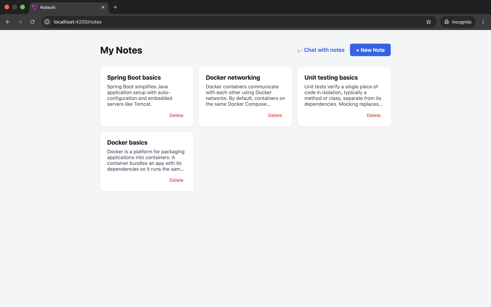
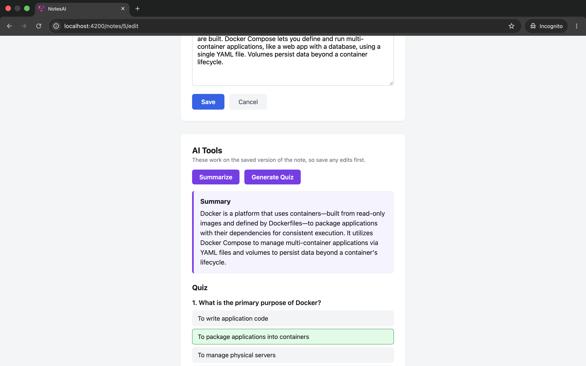
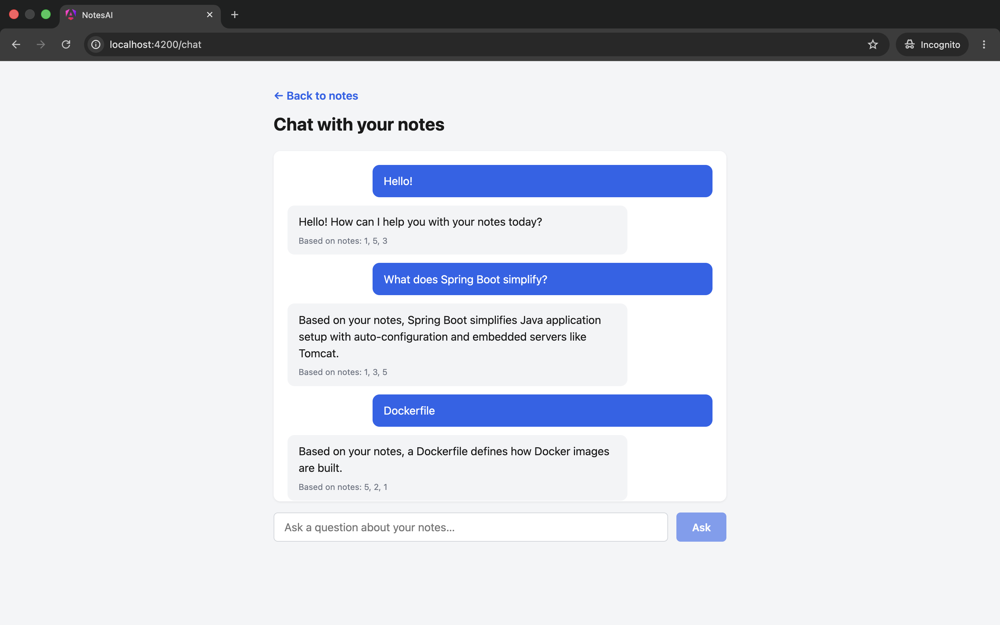
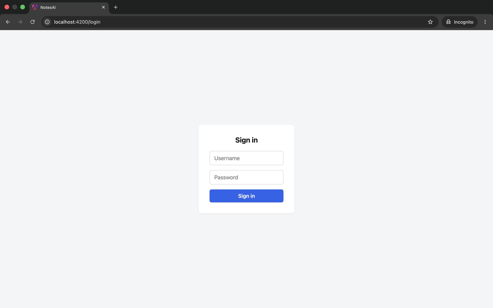
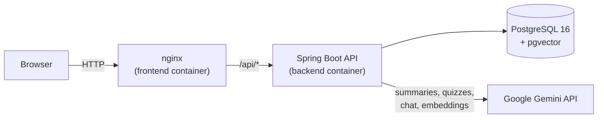

# NotesAI

[](https://github.com/RYS-GIT/notes-ai/actions/workflows/ci.yml)

An AI-powered notes and knowledge assistant. Write notes, then summarize them, turn them into quizzes, or ask questions across all of them in a chat that answers from your own notes.

Built as a full-stack learning project covering Spring Boot, Angular, PostgreSQL with pgvector, Docker, GitHub Actions CI, and deployment to AWS EC2.

## Features

- **Notes:** create, edit, list, and delete notes, with confirmation before deleting.
- **Summaries:** one click turns a note into a short summary.
- **Quizzes:** generates multiple-choice questions from a note. The quiz is interactive: it shows the correct answer and an explanation, and keeps a score.
- **Chat with your notes (RAG):** ask a question and get an answer grounded in your own notes, along with the IDs of the notes it used. The chat keeps the conversation history, so follow-ups like "tell me more" work.
- **Login:** the whole app sits behind a single shared login (HTTP Basic authentication).

## Screenshots

| Notes | AI tools |
| --- | --- |
|  |  |

| Chat with your notes | Login |
| --- | --- |
|  |  |

## Architecture



nginx serves the compiled Angular app and proxies `/api` to the backend, so the browser only ever talks to one origin. The backend and the database are not published to the host; they are reachable only inside the Docker network.

### How the chat works (retrieval-augmented generation)

1. **On save:** every time a note is created or updated, its title and content are turned into an embedding (a 768-dimension vector) with `gemini-embedding-001` and stored in PostgreSQL using the pgvector extension.
2. **On a question:** the question is embedded the same way, and pgvector returns the three closest notes by vector distance.
3. **Generation:** those notes, the earlier conversation, and the question go into a prompt for the Gemini chat model. The prompt tells the model to answer notes-related questions only from the retrieved notes, and to answer questions about the conversation itself (for example "what did I ask first?") from the history.
4. **Response:** the answer comes back with the IDs of the source notes.

## Tech stack

| Area | Technology |
| --- | --- |
| Backend | Java 21, Spring Boot 4, Spring Web, Spring Data JPA (Hibernate), Spring Security, Bean Validation, Maven |
| Frontend | Angular 22 (standalone components, signals), TypeScript, SCSS, Vitest |
| Database | PostgreSQL 16 with the pgvector extension |
| AI | Google Gemini API (chat model configurable, `gemini-embedding-001` for embeddings) |
| Infrastructure | Docker (multi-stage builds), Docker Compose, nginx |
| CI | GitHub Actions |
| Cloud | AWS EC2 (Ubuntu 24.04), security groups, AWS Budgets |

## API

All endpoints require HTTP Basic authentication.

| Method | Path | Description |
| --- | --- | --- |
| `GET` | `/api/notes` | List all notes |
| `POST` | `/api/notes` | Create a note |
| `GET` | `/api/notes/{id}` | Get one note |
| `PUT` | `/api/notes/{id}` | Update a note |
| `DELETE` | `/api/notes/{id}` | Delete a note |
| `POST` | `/api/notes/{id}/summarize` | Summarize a note |
| `POST` | `/api/notes/{id}/quiz?count=5` | Generate a quiz (1 to 10 questions) |
| `POST` | `/api/chat` | Ask a question across all notes (body: `question`, optional `history`) |

Errors come back as JSON with a status, an error name, and a message. A missing note returns 404, and an AI provider problem returns 503 (busy) or 502 (rejected or unusable response).

## Getting started

You need Docker and a free Gemini API key from [Google AI Studio](https://aistudio.google.com).

```bash
git clone https://github.com/RYS-GIT/notes-ai.git
cd notes-ai
```

Create a `.env` file in the project root:

```
GEMINI_API_KEY="your-gemini-key"
APP_USERNAME="admin"
APP_PASSWORD="choose-a-password"
```

Keep the double quotes. Docker Compose treats an unquoted `#` as the start of a comment.

Start everything:

```bash
docker compose up --build
```

Open <http://localhost:4200> and log in with the username and password from `.env`.

## Development without Docker

Run only the database in Docker, and the apps directly:

```bash
# Database
docker run --name notesai-postgres \
  -e POSTGRES_DB=notesai -e POSTGRES_USER=notesai -e POSTGRES_PASSWORD=notesai \
  -p 5432:5432 -d pgvector/pgvector:pg16

# Backend (needs Java 21)
cd backend
GEMINI_API_KEY=your-key APP_USERNAME=admin APP_PASSWORD=changeme ./mvnw spring-boot:run

# Frontend (needs Node 22), in another terminal
cd frontend
npm install
ng serve
```

`ng serve` proxies `/api` to the backend on port 8080 (see `frontend/proxy.conf.json`), so the app is at <http://localhost:4200>.

## Configuration

| Variable | Purpose | Default |
| --- | --- | --- |
| `GEMINI_API_KEY` | Gemini API key | none (required for the AI features) |
| `APP_USERNAME`, `APP_PASSWORD` | The shared login | `admin` / `changeme` (change these) |
| `DB_HOST`, `DB_USER`, `DB_PASSWORD` | Database connection | `localhost` / `notesai` / `notesai` |
| `FRONTEND_PORT` | Host port for the frontend in Docker Compose | `4200` |
| `FRONTEND_URL` | Allowed browser origin for CORS | `http://localhost:4200` |
| `gemini.model` (property) | Gemini chat model | set in `application.properties` |

## Testing and CI

```bash
cd backend && ./mvnw verify
cd frontend && npm test -- --watch=false
```

Every push and pull request to `main` runs two parallel jobs in GitHub Actions:

- **Backend:** builds and tests with Maven against a real `pgvector/pgvector:pg16` service container.
- **Frontend:** installs dependencies, runs the Vitest tests, and builds the app.

The tests are smoke tests for now: the backend test boots the Spring context against a real database, and the frontend tests check that each component and service can be created.

## Deployment (AWS EC2)

The same Docker Compose stack runs on a single EC2 instance (Ubuntu 24.04, `t3.small`, with a swap file for image builds).

- The security group allows SSH only from my own IP address, and HTTP/HTTPS from anywhere. The backend and database ports are not published.
- Secrets live in a `.env` file on the server and are never committed. The same keys are set as GitHub Actions secrets for CI.
- Containers use `restart: unless-stopped`, so the stack comes back after a reboot.
- An AWS Budget alert is in place, with an automated action that can stop the instance.
- The demo instance has since been torn down (instance, disk, and IP address released) to avoid ongoing costs. The setup is repeatable from this README and the Compose files.

## Design decisions

- **Same-origin API through nginx:** avoids hard-coding backend URLs in the frontend, removes most CORS complexity, and keeps the backend off the public network.
- **pgvector with `JdbcTemplate`:** vector storage and similarity queries use plain SQL, because JPA's support for the `vector` type is still limited. Everything else uses JPA.
- **Resilient AI calls:** server errors from the Gemini API are retried up to three times with exponential backoff, and failures are translated into clean 502 or 503 responses.
- **Prompt design:** a single "answer only from the notes" rule blocked questions about the conversation itself. Splitting the instructions into two cases fixed it.
- **Configuration through environment variables:** database credentials, the API key, and the login are never in the code.

## Known limitations and next steps

- **One shared login,** not per-user accounts. A multi-user version would add a users table, per-user notes, and JWT or session authentication.
- **No HTTPS in the demo deployment.** HTTP Basic credentials need HTTPS on a public site. Caddy with Let's Encrypt would be the next step.
- **Embeddings are generated synchronously on save,** so saving a note waits for an extra API call. A production version would do this in the background.
- **The database schema is created by Hibernate** (`ddl-auto=update`). A migration tool such as Flyway would be the production choice.
- **Chat retrieval uses only the latest question.** Rewriting the question with the conversation history before embedding it would improve follow-up questions.
- **The Gemini free tier has daily quotas,** so heavy use can lead to rate-limit errors.
